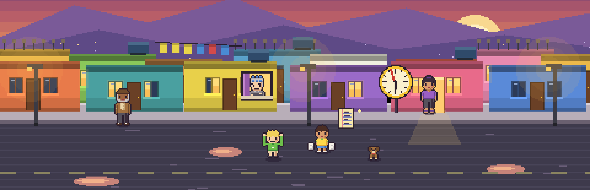
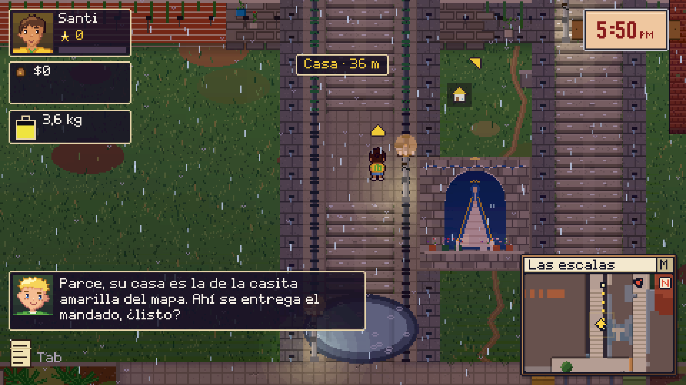
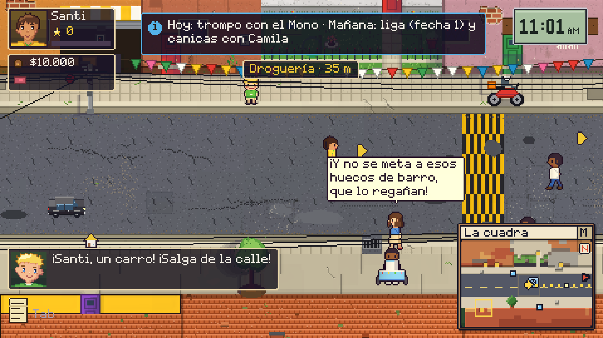
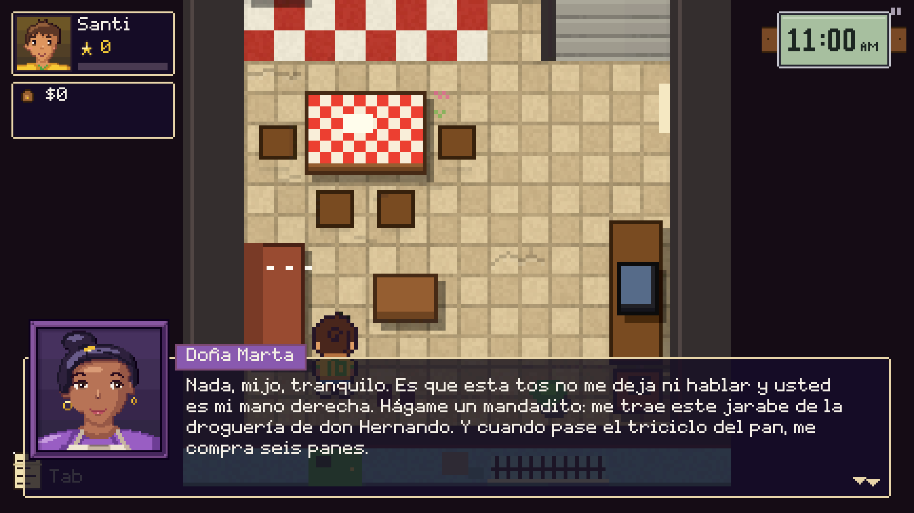
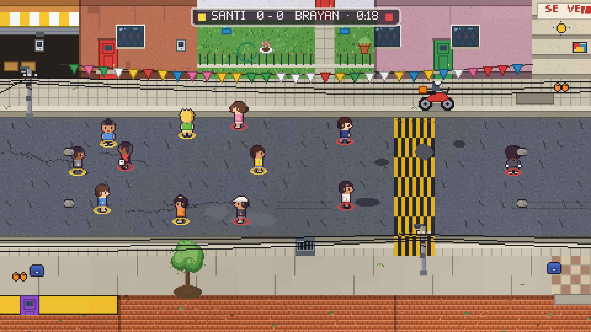
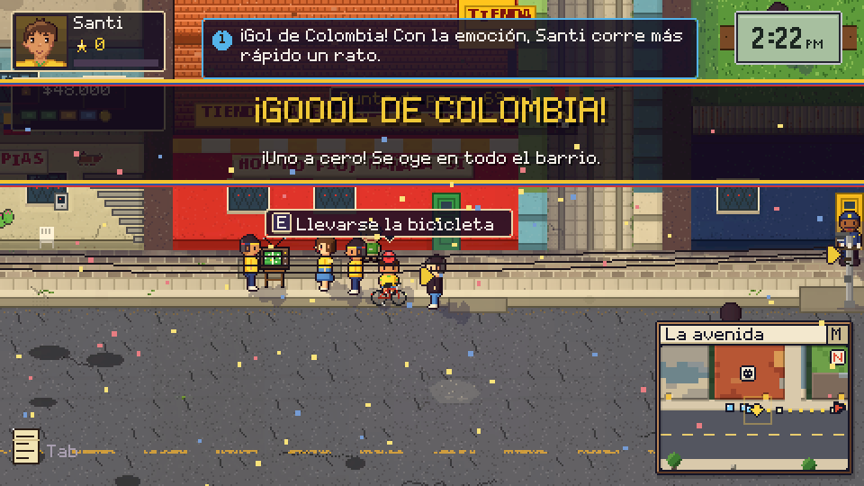
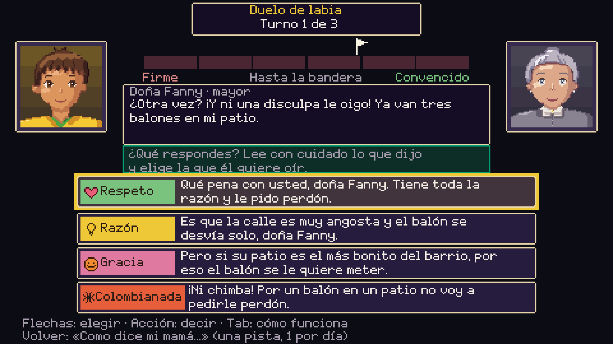

# El Mandado · demo de prueba

**Seis días, una lista y una mamá que espera antes de las seis.**

Santi tiene 14 años y tiene que hacer los mandados de su mamá en un barrio colombiano de ladera: la droguería, la pipeta del gas, el recibo de la luz, la tienda de don Chucho. El reloj corre, el papelito se moja, los vecinos opinan, hay reta en la cuadra y el miércoles juega la Selección.

Un juego de pixel art de **NEYA**. Hecho en Colombia.

## ⬇️ Descargar

**[Descargar el demo para Windows (78 MB)](../../releases/latest)**

🎬 **[Ver el tráiler (60 s)](../../releases/latest/download/El_Mandado_trailer.mp4)**

El demo trae el prólogo, el lunes y el martes: de 40 a 70 minutos. Solo en español por ahora.

1. Descomprime el `.zip` en una carpeta.
2. Doble clic en `ElMandado_demo_prueba.exe`.
3. Si Windows dice «Windows protegió tu PC»: **Más información** → **Ejecutar de todas formas**. Sale porque el juego es nuevo y todavía no tiene firma digital.

Requisitos: Windows 10 u 11 de 64 bits y una tarjeta de video compatible con Vulkan (casi todos los computadores de 2016 en adelante).

El juego **no se conecta a internet ni recoge datos**.

## Cómo se ve

| | |
|---|---|
|  |  |
|  |  |
|  |  |

## Controles

| Qué | Teclado | Mando |
|---|---|---|
| Moverse | W A S D o flechas | Palanca izquierda o cruceta |
| Acción / hablar | E, Espacio o Enter | A |
| Volver | Q o Retroceso | B |
| Correr | Shift | Gatillo izquierdo |
| Diario de Santi | Tab | Back / Select |
| Mapa | M | Y |
| Pausa y «Guardar aquí» | Esc | Start |

## Cuéntanos qué te pareció

Es una **versión de prueba** y puede tener errores: para eso la compartimos. Lo que más nos sirve es lo que **no** te gustó o no entendiste:

- ¿Dónde te perdiste o no supiste qué hacer?
- ¿Qué se sintió lento o aburrido?
- ¿Qué te hizo reír o te recordó tu barrio?
- ¿Encontraste un error? Dinos qué versión jugaste (sale abajo a la derecha en el menú).

Escríbelo en la publicación donde encontraste el juego, o abre un [reporte aquí](../../issues/new).

## Derechos

© 2026 NEYA. Todos los derechos reservados. Puedes descargarlo, jugarlo y compartir el enlace a esta página. Por favor no vuelvas a subir el archivo en otros sitios ni lo vendas. Este repositorio solo contiene el demo; el código del juego no es público.

---

## English

**Six days, one shopping list and a mom waiting before six.** Santi, 14, runs his mom's errands through a hillside Colombian neighborhood: the clock is ticking, the note gets wet, the neighbors have opinions, there's street soccer on the block, and on Wednesday the national team plays. A pixel-art game by **NEYA**, made in Colombia.

**[Download the Windows demo (78 MB)](../../releases/latest)** · **[Watch the trailer](../../releases/latest/download/El_Mandado_trailer.mp4)** — prologue, Monday and Tuesday, 40 to 70 minutes. **Spanish only for now.** Unzip and run `ElMandado_demo_prueba.exe`; if Windows says "Windows protected your PC", click "More info" → "Run anyway" (the build is not digitally signed yet). Requires 64-bit Windows 10/11 and a Vulkan-capable GPU. The game does not go online or collect any data.

This is a **test build**: feedback on where you got lost, what felt slow and any bugs is very welcome (reply in the post where you found it, or [open an issue](../../issues/new)).

© 2026 NEYA. All rights reserved. You may download, play and share the link to this page; please don't re-upload or sell the file. This repository only contains the demo; the game's source code is not public.
